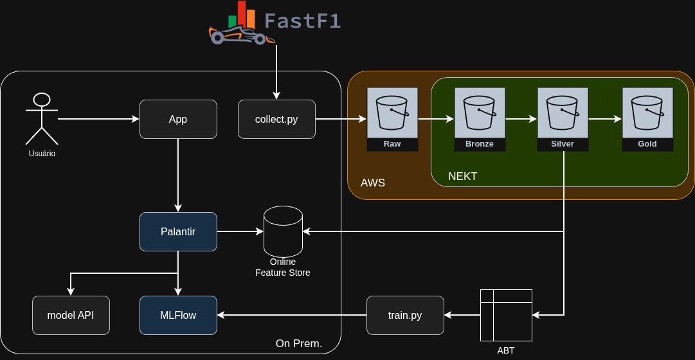

# F1 Lake — Pipeline de Engenharia de Dados

Projeto de estudo voltado à construção de uma arquitetura de dados end-to-end utilizando dados históricos da Fórmula 1.

A solução realiza a coleta, armazenamento, processamento e transformação dos dados, passando por diferentes camadas de um Lakehouse até disponibilizá-los para análises e modelos preditivos.

O projeto explora conceitos e tecnologias de Engenharia de Dados, incluindo Python, AWS S3, processamento em camadas Raw, Bronze, Silver e Gold, Feature Store, SQL, MLflow e integração com aplicações.

## Arquitetura

O pipeline foi estruturado para representar o fluxo completo dos dados, desde a coleta na fonte até o consumo por aplicações e modelos de Machine Learning.

## Etapas do projeto

- [Coleta](#coleta)
- [Envio dos dados](#envio-dos-dados)
- [Camada Raw](#camada-raw)
- [Camada Bronze](#camada-bronze)
- [Camada Silver](#camada-silver)
- [Camada Gold](#camada-gold)
- [Treinamento do modelo](#treinamento-do-modelo)
- [Aplicação para usuário](#aplicação-para-usuário)

### Coleta

A coleta dos dados históricos da Fórmula 1 é realizada em Python utilizando a biblioteca [FastF1](https://docs.fastf1.dev/).

O processo permite selecionar temporadas e tipos de sessão para realizar a extração dos dados. As informações coletadas são estruturadas e armazenadas em arquivos Parquet, preparando os dados para as próximas etapas do pipeline.

A coleta pode ser executada de forma automatizada, permitindo a atualização periódica dos dados.

Esta etapa será executada em um servidor próprio de maneira agendada.

### Envio dos dados

Após a coleta e geração dos arquivos Parquet, os dados são enviados para um bucket Amazon S3.

Essa etapa desacopla a coleta do processamento e disponibiliza os arquivos para as etapas seguintes do pipeline.

### Camada Raw

O Amazon S3 funciona como camada `raw` da arquitetura, armazenando os dados coletados antes das transformações realizadas no Lakehouse.

Essa camada preserva os dados de origem e serve como ponto inicial para os processos de ingestão e transformação das camadas seguintes.

### Camada Bronze

Na camada Bronze, os dados provenientes da camada Raw são ingeridos no Lakehouse e armazenados em formato Delta.

O objetivo dessa camada é manter os dados próximos à estrutura original da fonte, criando uma primeira camada estruturada e persistente para as transformações posteriores.

O uso do formato Delta permite trabalhar com versionamento e histórico das alterações realizadas nos dados.

### Camada Silver

Na camada Silver, os dados provenientes da Bronze passam por processos de transformação, limpeza e modelagem para gerar estruturas mais consistentes e adequadas ao consumo.

Nesta etapa também são construídas Feature Stores com o histórico das entidades relevantes do projeto, permitindo reutilizar dados preparados na criação de features e nas etapas posteriores de Machine Learning.

A camada Silver representa, portanto, a transição dos dados mais próximos da origem para estruturas tratadas e organizadas de acordo com as necessidades analíticas do projeto.

### Camada Gold

Na camada Gold, os dados já tratados e modelados são organizados em estruturas voltadas ao consumo final.

Essa camada disponibiliza dados sumarizados e preparados para análises, relatórios e integração com ferramentas de BI e dashboards.

O objetivo é facilitar o acesso às informações sem que as aplicações consumidoras precisem lidar diretamente com as etapas anteriores de tratamento e transformação.

### Treinamento do Modelo

A partir dos dados tratados na camada Silver e das Feature Stores, é construída uma Analytical Base Table (ABT) com as variáveis necessárias para o treinamento dos modelos de Machine Learning.

Os experimentos e modelos são gerenciados com MLflow, permitindo registrar execuções, parâmetros e métricas durante o processo de treinamento.

Essa etapa demonstra como os dados preparados ao longo do pipeline podem ser utilizados por aplicações de Machine Learning.

### Aplicação para usuário

Após o treinamento, o modelo é disponibilizado para consumo por meio de uma API, permitindo separar a camada de Machine Learning da aplicação final.

Uma interface desenvolvida em Streamlit consome as predições e apresenta os resultados ao usuário de forma interativa.

Essa etapa fecha o fluxo end-to-end do projeto, conectando a coleta e o processamento dos dados até o consumo final das informações.

## Tecnologias utilizadas

- **Python** — coleta e processamento dos dados
- **FastF1** — fonte dos dados históricos da Fórmula 1
- **Parquet** — armazenamento dos dados coletados
- **AWS S3** — armazenamento da camada Raw
- **SQL** — transformação e modelagem dos dados
- **Delta** — armazenamento das camadas do Lakehouse
- **MLflow** — gerenciamento dos experimentos de Machine Learning
- **Streamlit** — interface para consumo das predições
- **Docker** — execução dos serviços da aplicação

## Aprendizados

Durante o desenvolvimento deste projeto, foram praticados conceitos importantes de Engenharia de Dados, como:

- Construção de um pipeline de dados end-to-end
- Coleta e armazenamento de dados em formato Parquet
- Armazenamento de dados na AWS utilizando Amazon S3
- Organização de dados em camadas Raw, Bronze, Silver e Gold
- Transformação e modelagem de dados com SQL
- Construção de Feature Stores e ABT para Machine Learning
- Integração entre pipeline de dados, modelo preditivo, API e aplicação